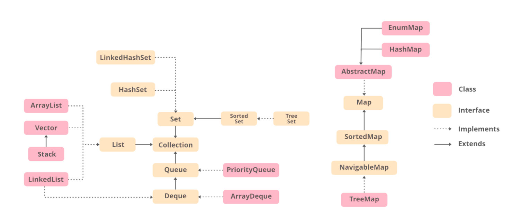

# 02 · Java Collections Framework

| File | Concepts |
|---|---|
| `ListExamples.java` | `ArrayList` vs `LinkedList`, immutable `List.of`, safe removal (`removeIf`), `SequencedCollection` (Java 21+) |
| `SetAndMapExamples.java` | `HashSet`/`LinkedHashSet`/`TreeSet`, `HashMap` internals, `merge`/`computeIfAbsent`, LRU cache via `LinkedHashMap` |
| `QueueAndSortingExamples.java` | `ArrayDeque` as stack/queue, `PriorityQueue`, `Comparator.comparing().thenComparing()` |

Run: `./mvnw -pl 02-collections test`

## Big-O cheat sheet
| Structure | get | add | contains | remove |
|---|---|---|---|---|
| `ArrayList` | O(1) | O(1)* | O(n) | O(n) |
| `LinkedList` | O(n) | O(1) | O(n) | O(1) at ends |
| `HashMap` / `HashSet` | O(1) | O(1) | O(1) | O(1) |
| `TreeMap` / `TreeSet` | O(log n) | O(log n) | O(log n) | O(log n) |
| `PriorityQueue` | peek O(1) | O(log n) | O(n) | poll O(log n) |

## Most asked interview questions
1. **How does `HashMap` work?** — array of buckets, `hashCode` → index, `equals` resolves collisions; buckets become red-black trees after 8 entries; resizes at load factor 0.75.
2. **Why override `hashCode` when overriding `equals`?** — otherwise equal keys land in different buckets.
3. **`ArrayList` vs `LinkedList`** — almost always `ArrayList` (cache-friendly); use `ArrayDeque` for queues/stacks.
4. **`HashMap` vs `LinkedHashMap` vs `TreeMap`** — no order / insertion (or access) order / sorted.
5. **`HashMap` vs `ConcurrentHashMap` vs `Collections.synchronizedMap`** — CHM uses fine-grained locking + CAS and doesn't allow null keys/values.
6. **Fail-fast vs fail-safe iterators** — `ConcurrentModificationException` vs copy-on-write/weakly consistent.
7. **`Comparable` vs `Comparator`** — natural order inside the class vs external strategies.
8. **`List.of` vs `Arrays.asList` vs `Collections.unmodifiableList`** — truly immutable / fixed-size view / read-only view.
9. **Why must map keys be immutable?** — a mutated key's hash changes and the entry is "lost".
10. **How do you build an LRU cache?** — `LinkedHashMap(accessOrder=true)` + `removeEldestEntry`.

## Best practices
- Program to interfaces: `List<String> names = new ArrayList<>();`.
- Return empty collections, never `null`.
- Pre-size big collections when the size is known.
- Use `getFirst()/getLast()/reversed()` from `SequencedCollection` instead of index arithmetic.

## Common pitfalls
- Removing inside a for-each loop → `ConcurrentModificationException` (use `removeIf` or an `Iterator`).
- `List.of(...)` is immutable and rejects `null`.
- Using mutable objects (or arrays) as map keys.
- `TreeSet` uses `compareTo`, not `equals`, for uniqueness.
